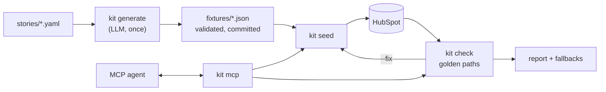

# demo-environment-kit

**Keeps demo environments realistic, current and verified before every call.**

Sales reps often maintain their own demo accounts by hand. The data goes stale: close dates drift into the
past, the "recent" activity is from last quarter, and someone edits the hero deal the day before. The rep
finds out live, in front of the customer.

This kit treats a demo environment like software:

- **Describe** a demo story in one YAML file: industry, hero accounts, who's the champion, who's skeptical, what happened over the last six weeks.
- **Generate** realistic data that agrees with itself, once, with an LLM. Then validate it and commit it.
- **Seed** it into a real SaaS product (HubSpot), with every date relative to today, so it never goes stale.
- **Check** the golden paths a rep will show before every call, with fallbacks and a one-command fix.
- **Reset** on command, touching only the records the kit created.
- **Hand it to an agent** over MCP: *"Get a healthcare demo ready for Acme and tell me if anything's broken."*

▶ **2-minute video:** *(link to be added)*

## Measured results

<!-- METRICS:START -->
Live HubSpot test account, 2026-10-27. Each story ran 10 times: reset, seed from scratch, run all four golden-path checks.
Numbers are exactly what `kit metrics` reports from the ledger ([`runs/ledger.sample.jsonl`](runs/ledger.sample.jsonl)), not rounded.

Batch `readme-2026-10-27b`:

| Story | Runs | Records (+links) | Seed p50 | Seed p95 | Reset p50 | Checks passing on fresh seed |
|---|---|---|---|---|---|---|
| finserv | 10 | 129 (+190) | 14.53 s | 16.76 s | 6.24 s | 10/10 (100%) |
| healthcare | 10 | 128 (+187) | 14.73 s | 16.85 s | 6.08 s | 10/10 (100%) |
| manufacturing | 10 | 124 (+187) | 14.37 s | 15.38 s | 6.24 s | 10/10 (100%) |

p95 uses the nearest-rank method, so with 10 runs it is the slowest run. Checks ran after a 15 s pause for
HubSpot search to catch up; the pause is not counted in any time. An earlier batch stopped after 22 runs
when HubSpot dropped a connection mid-seed. That exposed a missing retry, which is now fixed, and this
batch was then run from the start.
<!-- METRICS:END -->

## How it works



1. **Generation is separate from loading.** The LLM writes fixtures once and they're committed. Seeding is deterministic, so nothing gets made up during a live demo.
2. **Relative time.** Fixtures say `days_ago: 12`, never a date. Data seeded months later still looks current.
3. **Every record is tagged** (`demo_kit_id`, `demo_kit_story`). Seeding twice changes nothing; reset never deletes anything untagged. Both are tested, and both were verified on a live account.
4. **Fictional data only:** invented companies, `*.example.com` domains, 555-01xx phone numbers. Validation enforces this.
5. **Measured.** Every command writes to `runs/ledger.jsonl`; the table above comes from it.

More detail in [docs/architecture.md](docs/architecture.md), including how a Salesforce or ServiceNow adapter would plug in.

## Golden paths

Each is a short YAML file in [`checks/`](checks), shared by every story:

| Golden path | What the rep shows | Checked |
|---|---|---|
| Pipeline review | The deals board | ≥30 open deals, ≥4 stages, nothing overdue, every open deal has a next step |
| Deal deep-dive | Each hero deal | Story stage, future close date, ≥2 contacts, ≥3 activities in 30 days, newest under 10 days |
| Account 360 | Each hero company | ≥2 contacts, ≥1 deal, activity under 10 days old |
| Rep activity feed | The rep's own week | ≥5 activities in 14 days, ≥2 upcoming tasks or meetings |

A failing path shows what broke, a **fallback** for the call ([`fallbacks/`](fallbacks)), and a
**remediation**. `kit check <story> --fix` runs the remediation and checks again.

## Stories

| Story | Hero accounts | Seller |
|---|---|---|
| `healthcare` | Acme Regional Health, Northfield Family Clinics | patient-intake platform |
| `finserv` | Quillstone Community Bank, Fernhollow Credit Union | digital account opening and KYC |
| `manufacturing` | Kilnbrook Precision Castings, Marrowfield Packaging Group | predictive maintenance |

Each also has 25 background accounts and 40 deals, so pipeline views look like a real team's book.

## Quickstart

Needs Python 3.12, [uv](https://docs.astral.sh/uv/), a HubSpot developer test account with a service key
(the 14 scopes are listed in [docs/hubspot-notes.md](docs/hubspot-notes.md)), and an Anthropic API key if
you want to generate new stories.

```sh
uv sync
cp .env.example .env                  # add HUBSPOT_TOKEN (and ANTHROPIC_API_KEY for generate)
uv run kit ping                       # token works? lists your deal stages
uv run kit seed healthcare --dry-run  # see what would be written
uv run kit seed healthcare            # ~190 records
uv run kit check healthcare           # all golden paths, with a report in reports/

uv run kit break healthcare           # damage the hero deal on purpose
uv run kit check healthcare --fix     # caught, fixed, checked again

uv run kit reset healthcare           # remove only what the kit created
uv run kit reset healthcare --reseed  # after `kit generate`: clears records the new fixtures no longer have
uv run kit metrics                    # the table above, from the ledger
uv run pytest                         # live HubSpot tests are skipped without a token
```

### With an agent (MCP)

`uv run kit mcp` starts an MCP server with `list_stories`, `generate_story`, `seed_story`, `check_story`,
`reset_story` (needs `confirm=true`) and `get_last_report`. Client setup is in [docs/mcp.md](docs/mcp.md).
To run the scenario from the video:

```sh
uv run python examples/get_acme_ready.py
```

## Commands

| Command | What it does |
|---|---|
| `kit generate <story>` | LLM → validated fixtures in `fixtures/<story>/` |
| `kit validate <story>` | Re-check saved fixtures (no LLM, no HubSpot) |
| `kit seed <story> [--dry-run]` | Load fixtures into HubSpot; safe to repeat |
| `kit check <story> [--fix]` | Golden paths → terminal table + `reports/*.md` / `.json` |
| `kit reset <story> \| --all [--reseed]` | Delete kit-tagged records only |
| `kit break <story>` | Damage the hero deal, to demo `--fix` |
| `kit stories` | Stories, fixtures and last results |
| `kit metrics` | README numbers from the ledger |
| `kit mcp` | MCP server for agents |

## Stack

Python 3.12 · uv · typer · httpx · pydantic · the official MCP Python SDK · pytest. Fixture generation
calls Claude (`claude-opus-5-5` by default, configurable with `KIT_LLM_MODEL`) with structured output.
HubSpot's dated REST API (`2026-09`).

Built with AI assistance.
