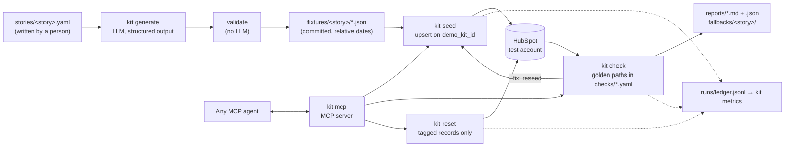

# Architecture

## The pieces

| Module | Job |
|---|---|
| `schemas.py` | Pydantic models for story files and fixtures. Enforces the fictional-data rules per field. |
| `generate.py` | One LLM call per hero account plus one for filler, with structured output. The LLM writes the creative text. Code assigns IDs, emails, phone numbers and links between records. |
| `validate.py` | Cross-record checks after generation: links point at real records, emails match the company domain, every hero persona exists, no fixed dates in text, no company reused across stories. |
| `seed.py` | Builds a plan (records + links) from fixtures, then upserts and links. Dates resolve from the start of today, so same-day reseeds write identical values. |
| `reset.py` | Finds records by search and by direct `demo_kit_id` lookup, then re-checks each record's own story tag before deleting it. |
| `check.py` | Reads one snapshot of what a rep would see, then evaluates the golden-path assertions in plain Python. |
| `report.py` | Terminal table, JSON and Markdown reports. |
| `actions.py` | Every command as a plain function. The CLI and the MCP server both call these. |
| `hubspot.py` | The only file that talks to HubSpot: auth, dated API version, retries, batching. |
| `ledger.py`, `metrics.py` | One JSON line per command; README numbers come from these lines. |

## Design rules

1. **Generation is separate from loading.** The LLM runs once and its output is committed. Seeding is deterministic and never calls an LLM, so nothing gets invented halfway through a live demo.
2. **Relative time.** Fixtures say `days_ago: 12`, never a date. Data seeded months later still looks current (there's a test that seeds 400 days later and checks every golden path).
3. **Every record is tagged** with `demo_kit_id` and `demo_kit_story`. Upsert, reset and checks match on these tags. Reset never deletes a record without the right tag, even if a lookup returns it by mistake.
4. **Safe to run twice.** Verified on a live account: a second seed left every record, field and link identical.
5. **Measured.** Every command writes to the ledger; `kit metrics` turns a labelled batch into the README table.

## Adding another CRM (adapter note)

Only `hubspot.py` and the field mapping in `seed.py` / `check.py` know about HubSpot. Stories, fixtures, validation, golden-path files, reports, the ledger and the MCP server are CRM-neutral. A new target needs an adapter with the same methods the seeder, reset and checks call:

| Method | HubSpot | Salesforce | ServiceNow (CSM) |
|---|---|---|---|
| Tag fields | custom properties `demo_kit_id` (unique), `demo_kit_story` | custom fields `Demo_Kit_Id__c` (External ID, unique), `Demo_Kit_Story__c` | custom columns `u_demo_kit_id`, `u_demo_kit_story` |
| `batch_upsert` | `/crm/objects/{v}/{type}/batch/upsert` with `idProperty` | Composite/sObject Collections upsert on the External ID field | Import Set API with a coalesce field on `u_demo_kit_id` |
| `read_by_kit_ids` / `find_by_story` | batch read by `idProperty` / CRM search | SOQL `WHERE Demo_Kit_Story__c = …` | Table API query on `u_demo_kit_story` |
| `associate` | associations API with type IDs | lookup fields (`AccountId`, `ContactId` on `OpportunityContactRole`) set during upsert | reference fields set during import |
| `archive` | batch archive (recycle bin) | Composite delete (recycle bin) | Table API delete |
| Activities | notes, calls, emails, meetings, tasks objects | `Task` / `Event` with `WhatId` / `WhoId` | interactions and tasks |

The golden-path files would stay as they are. Only `gather()` in `check.py` would read the snapshot from the other system.
